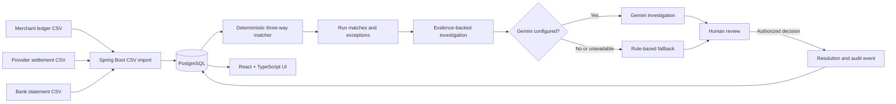
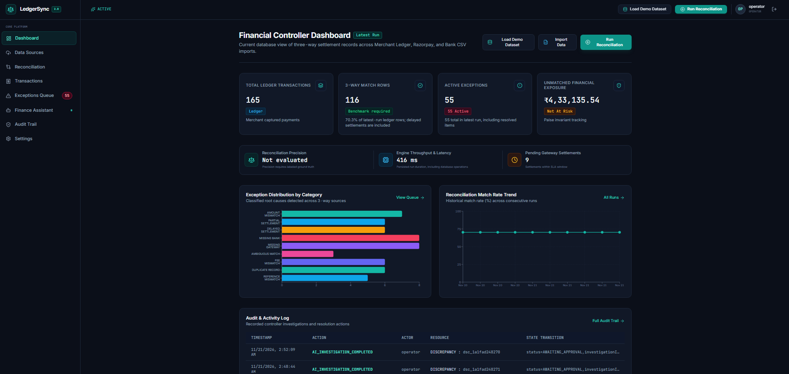
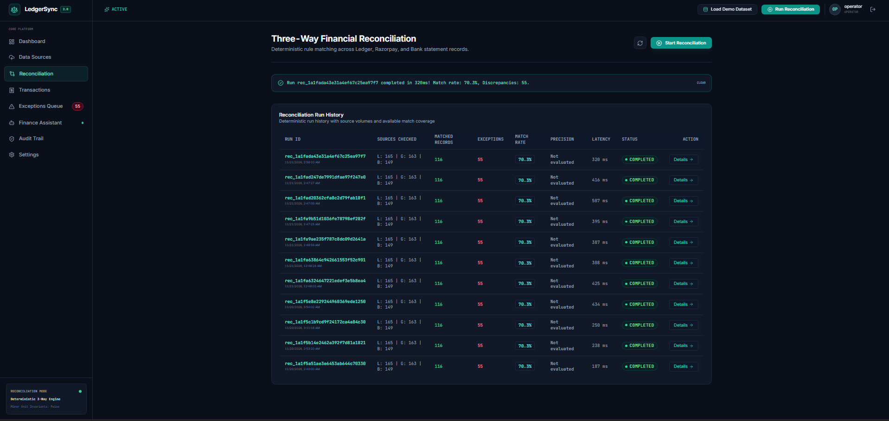
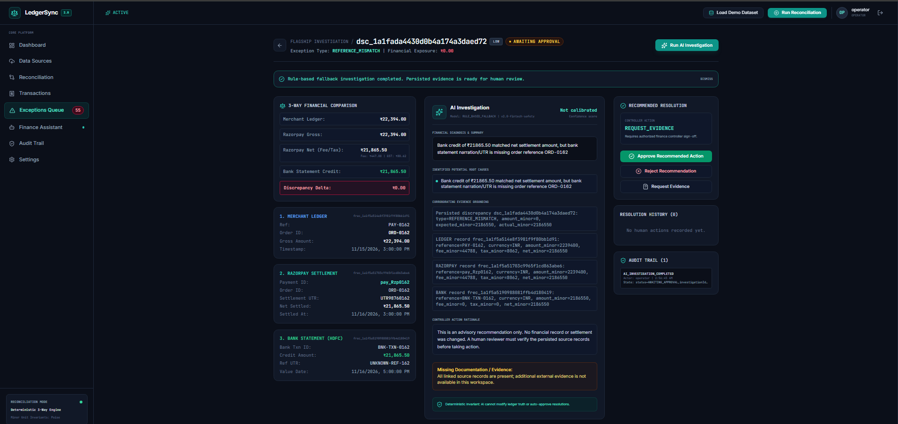
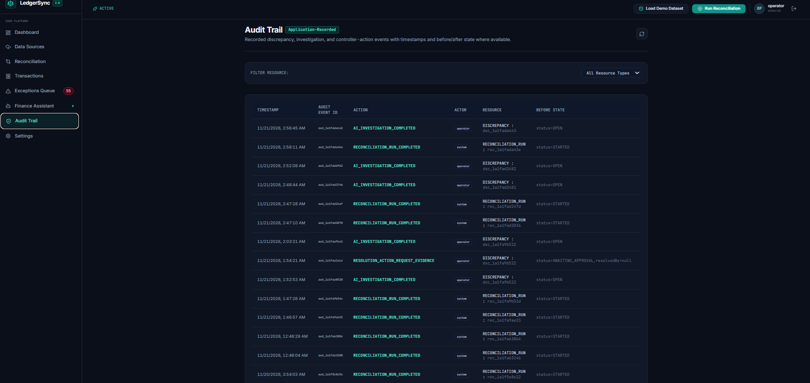

# LedgerSync — AI-Assisted Financial Reconciliation & Investigation

Reconcile merchant, payment-provider, and bank records with deterministic matching, then investigate exceptions using persisted evidence and human-controlled decisions.

[](https://openjdk.org/)
[](https://spring.io/projects/spring-boot)
[](https://www.postgresql.org/)
[](https://react.dev/)
[](https://www.typescriptlang.org/)
[](https://vitejs.dev/)

**The core distinction:** financial matching is deterministic; AI is advisory and evidence-grounded; authorized people control resolution; actions are recorded in an application audit trail.

## The problem

Finance teams compare captured payments, provider settlements, and bank credits across separate exports. Missing records, duplicates, fee/tax differences, late settlements, and ambiguous references require investigation before anyone can safely resolve them.

## What LedgerSync does

LedgerSync imports complete CSV snapshots from three sources, runs a deterministic three-way reconciliation, and presents detected discrepancies with linked source evidence. A finance operator can request an investigation, review its recommendation, and approve or reject a supported action. The service records successful actions and audit events transactionally.

## Key capabilities

- CSV imports for merchant **LEDGER**, **RAZORPAY**, and **BANK** sources, with row diagnostics and exact-file repeat-upload idempotency.
- Three-way matching against the latest completed full import batch for each source.
- Integer minor-unit monetary storage and calculations (paise for INR).
- Exception queue, transaction explorer, reconciliation run history, Finance Assistant, and audit history.
- Investigation using Gemini when configured, with a deterministic rule-based fallback when it is unavailable or unconfigured.
- Server-side role checks and human approval controls; AI recommendations do not directly approve or mutate financial source records.
- Existing payment/webhook and inbox/retry/dead-letter components.

## Architecture



The matching engine does not read `demo-data/ground_truth.json`. That file is consumed only by the separate post-run evaluation script.

## Three-way reconciliation workflow

1. Import a complete snapshot for each source. Partial uploads are not combined.
2. The matcher selects each source's latest completed batch and persists those batch IDs on the run.
3. It links records using source references, order identifiers, currency, amount, fee/tax, and settlement data.
4. It records confirmed matches separately from exceptions. A delayed settlement can have a match row and a delay exception, so these counts are not complements.
5. Ambiguous candidates are flagged rather than arbitrarily or repeatedly matched.

Amounts are represented as integer minor units. The documented settlement invariant is `net = gross - fee - tax + signed adjustments`; the 72-hour delayed-settlement threshold and configured fee/tax rules must be checked against a merchant's contract before operational use.

## Exception detection and investigation

The matcher classifies missing gateway or bank records, amount mismatches, duplicates, fee/tax discrepancies, partial or delayed settlements, reference mismatches, and ambiguous candidates. An investigation receives persisted discrepancy/source evidence and stores its result for review. If Gemini is not configured or available, the UI can report a clearly labeled rule-based fallback; live Gemini generation has **not** been verified.

## AI and human-approval safeguards

- Reconciliation decisions are made by Java rules, not an LLM.
- The AI investigation is advisory; it cannot approve, force a match, or directly mutate financial source records.
- Server-side authorization protects financial actions; repeated/concurrent resolution attempts are guarded.
- Resolution actions and corresponding audit events are written transactionally.
- Audit history is application-recorded, not cryptographically immutable against a database administrator.

## Tech stack

| Area | Technologies |
|---|---|
| Backend | Java 21, Spring Boot 3.3.4, Maven |
| Persistence | PostgreSQL 16, Spring Data JPA, Flyway |
| Async/cache integration | Redis 7; inbox, retry, and dead-letter processing |
| Frontend | React 18, TypeScript, Vite, Tailwind CSS |
| Optional investigation provider | Gemini API via server-side `GEMINI_API_KEY`; deterministic fallback available |
| Local development | Docker Compose, Windows PowerShell scripts |

## Screenshots

Screens show the local synthetic/demo application. Displayed run counts and match coverage are illustrative persisted demo data, not benchmark precision or accuracy. The investigation view shown uses the labeled **rule-based fallback**.

| Dashboard | Reconciliation |
|---|---|
| <br><sub>Current dashboard metrics and persisted activity.</sub> | <br><sub>Run history; match coverage is not precision.</sub> |

| Investigation | Audit trail |
|---|---|
| <br><sub>Source evidence, fallback recommendation, and human controls.</sub> | <br><sub>Application-recorded investigation and reconciliation events.</sub> |

## Quickstart (Windows PowerShell)

Prerequisites: Docker Desktop with Compose v2, Java 21, Node.js 20+, and npm 10+.

From the repository root, start PostgreSQL and Redis:

```powershell
.\scripts\run-local.ps1
```

The script creates `.env` from `.env.example` only when it does not exist, and starts the database and Redis containers without removing named volumes. In two other PowerShell terminals, start the backend and frontend:

```powershell
.\scripts\start-backend.ps1
```

```powershell
.\scripts\start-frontend.ps1
```

Open `http://localhost:5173`. Local example sign-in credentials are `operator` / `operator` and `admin` / `admin`; replace them outside local development. The backend is at `http://localhost:8080`, health check at `/actuator/health`, and Swagger UI at `/swagger-ui.html`.

### Demo workflow

Sign in as `operator`, choose **Load Demo Dataset**, then **Run Reconciliation**. Open an exception and request an investigation. Without a configured Gemini key, expect a deterministic fallback. Review and approve or reject a permitted action, then inspect its audit event. Demo reset and force reload are administrator-only; do not use them against shared or persistent data.

## Environment configuration

The local startup scripts read `.env`; keep it private and do not commit it. The template is [.env.example](.env.example). Important variables:

| Variables | Purpose |
|---|---|
| `POSTGRES_DB`, `POSTGRES_USER`, `POSTGRES_PASSWORD`, `POSTGRES_HOST_PORT` | Compose PostgreSQL credentials and published port (default `5433`). |
| `SPRING_DATASOURCE_URL`, `SPRING_DATASOURCE_USERNAME`, `SPRING_DATASOURCE_PASSWORD` | Backend PostgreSQL connection. |
| `REDIS_HOST_PORT`, `SPRING_DATA_REDIS_HOST`, `SPRING_DATA_REDIS_PORT`, `SPRING_DATA_REDIS_PASSWORD` | Redis port mapping and backend connection (default host port `6380`). |
| `LEDGERSYNC_OPERATOR_USERNAME`, `LEDGERSYNC_OPERATOR_PASSWORD`, `LEDGERSYNC_ADMIN_USERNAME`, `LEDGERSYNC_ADMIN_PASSWORD` | Local browser accounts; change for non-local environments. |
| `LEDGERSYNC_SECURITY_API_KEYS_INGESTION`, `LEDGERSYNC_SECURITY_API_KEYS_OPERATOR`, `LEDGERSYNC_SECURITY_API_KEYS_ADMIN` | Optional API-key clients; blank by default. |
| `LEDGERSYNC_WEBHOOK_STRIPE_SECRET`, `LEDGERSYNC_WEBHOOK_RAZORPAY_SECRET` | Optional webhook signing secrets; verification fails closed if unset. |
| `GEMINI_API_KEY`, `GEMINI_MODEL` | Optional server-side Gemini access. A blank key uses the fallback. Never expose the key through a `VITE_` variable. |
| `VITE_BACKEND_URL`, `VITE_API_BASE_URL` | Vite proxy target and optional direct API base; local defaults are documented in `.env.example`. |

## Sample CSV formats

The included synthetic snapshots are in [`demo-data/`](demo-data/). Required headers:

| Source | CSV header |
|---|---|
| LEDGER | `ledger_id,order_id,customer_id,currency,amount,fee,tax,created_at,description,status` |
| RAZORPAY | `payment_id,settlement_id,order_id,arn_utr,currency,gross_amount,fee,tax,net_amount,settled_at,payment_method,status` |
| BANK | `bank_txn_id,account_number,value_date,credit_amount,debit_amount,currency,reference_utr,description,balance` |

Templates are available from `GET /api/v1/finance/imports/templates/{ledger|razorpay|bank}`. CSV amounts must be valid decimal currency values with no fractions smaller than one minor unit. Imports support UTF-8 CSV, including quoted multiline fields.

## Tests and benchmark

Verified in the engineering report:

| Check | Result |
|---|---|
| `.\mvnw.cmd test` | **53 passed; 0 failures, errors, or skips.** |
| `Set-Location frontend; npm run build` | **Passed**; TypeScript and Vite production build completed. Vite emitted a large-chunk advisory (~694 kB minified JS). |

Reproduce the code checks:

```powershell
.\mvnw.cmd test
Set-Location frontend
npm run build
Set-Location ..
```

The benchmark script is `.\scripts\evaluate-ground-truth.ps1`. **Current-code precision, recall, and F1 have not been evaluated:** the existing local run lacks the V6 three-source batch snapshot required by the evaluator. A historical report recorded 165/165 expected classifications on synthetic in-sample data before batch-snapshot scoping; it is not a current-code or held-out result. Do not interpret the UI's 70.3% match coverage as precision or accuracy. See [evaluation methodology and limitations](docs/evaluation-metrics.md) and [engineering verification evidence](docs/FINAL_ENGINEERING_VERIFICATION.md).

## Security, limitations, and future work

- Live Gemini generation, PostgreSQL-backed verification of the current V6 flow, and a fresh current-code benchmark remain unverified.
- Source imports are complete snapshots; incremental batches are not merged. Byte-identical uploads are idempotent, but concurrent duplicate-upload behavior against PostgreSQL is not verified.
- No independent held-out dataset or production accuracy claim is available.
- The local app has not been deployed to AWS or Vercel. Cloud files require environment-specific infrastructure and secret configuration; they are not turnkey deployment instructions.
- Next verification work: test V6 and imports on a dedicated disposable database, run the evaluator on a fresh snapshot, and complete authorized real-provider and narrow-viewport checks.

## API entry points

The browser uses session login at `/api/v1/auth/login`. Key endpoints include:

| Purpose | Endpoint |
|---|---|
| Upload CSV | `POST /api/v1/finance/imports/upload` |
| Load demo | `POST /api/v1/finance/imports/demo/load` |
| Reconcile | `POST /api/v1/finance/reconciliation/run` |
| List exceptions / investigate / resolve | `/api/v1/finance/exceptions` |
| Finance Assistant | `POST /api/v1/finance/assistant/query` |
| Audit history | `GET /api/v1/finance/audit` |

Interactive API reference: `http://localhost:8080/swagger-ui.html` after local startup.
