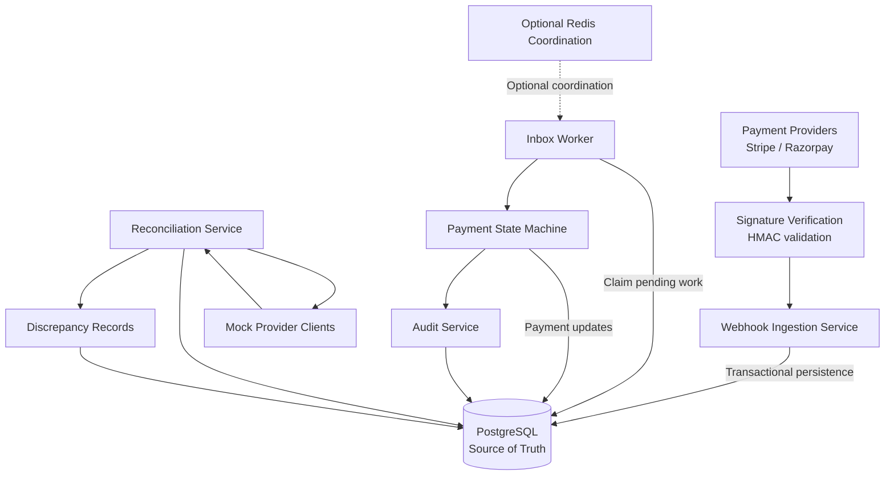

# LedgerSync

**A payment webhook ingestion and reconciliation backend built with Java, Spring Boot, PostgreSQL and Redis.**

LedgerSync demonstrates how a backend system can accept payment webhooks safely, process them asynchronously, maintain payment state, recover from processing failures and identify discrepancies through reconciliation.

The project focuses on correctness at the database boundary, explicit failure handling and verifiable behavior rather than claiming guarantees that a distributed system cannot universally provide.

---

## Contents

- [Overview](#overview)
- [Architecture](#architecture)
- [Core workflows](#core-workflows)
- [Engineering decisions](#engineering-decisions)
- [Data integrity](#data-integrity)
- [Security](#security)
- [Observability](#observability)
- [Technology stack](#technology-stack)
- [Local setup](#local-setup)
- [API reference](#api-reference)
- [Verification and evidence](#verification-and-evidence)
- [Project structure](#project-structure)
- [Known limitations](#known-limitations)

---

## Overview

Payment providers commonly deliver webhooks using an at-least-once delivery model. A provider may resend an event when an acknowledgement is delayed or lost.

A backend must therefore handle more than receiving an HTTP request. It must also account for duplicate deliveries, invalid signatures, concurrent processing, worker failures, invalid payment transitions and differences between internal payment records and provider-side records.

LedgerSync implements the following workflows:

- Stripe and Razorpay webhook ingestion with provider-specific HMAC signature verification.
- Database-backed webhook deduplication.
- Transactional webhook and inbox persistence.
- Asynchronous inbox processing using PostgreSQL row locking.
- Payment lifecycle and refund state transitions.
- Retry handling, dead-letter storage and controlled redrive.
- Optional Redis coordination with PostgreSQL-based processing fallback.
- Reconciliation runs, discrepancy tracking and audited resolution.
- API-key authentication and role-based authorization.
- Application health checks, metrics and correlation identifiers.

This is an engineering project demonstrating these mechanisms. It is not a live payment processor or a production integration with payment-provider settlement APIs.

## Architecture



PostgreSQL is the persistent source of truth. Redis is an optional coordination component; database row locking remains the important protection for concurrent inbox processing.

### Request and processing flow

1. A provider sends a webhook.
2. The application verifies its signature before accepting the event.
3. The ingestion service persists the webhook and corresponding inbox message transactionally.
4. A worker claims pending inbox messages using PostgreSQL locking.
5. The payment processing service applies the relevant state transition.
6. Payment changes and associated audit records are persisted.
7. Failed messages are retried and eventually moved to the dead-letter state when the retry limit is reached.

Reconciliation runs separately from normal webhook processing and records discrepancies for investigation.

For a more detailed view, see [Architecture and design](docs/architecture.md).

## Core workflows

### 1. Webhook ingestion and idempotency

Supported ingestion routes:

- `POST /api/v1/webhooks/stripe`
- `POST /api/v1/webhooks/razorpay`
- `POST /api/v1/webhooks/{provider}`

Stripe signatures are calculated using HMAC-SHA256 over the timestamp and raw request body. Timestamp tolerance is configurable, with a default of 300 seconds.

Razorpay signature verification uses HMAC-SHA256 over the raw request body.

Webhook identity is protected by a database uniqueness constraint. Repeated deliveries of the same provider event are acknowledged as duplicates instead of creating another processing record.

### 2. Asynchronous inbox processing

Accepted webhooks are persisted with inbox messages before asynchronous processing.

Workers claim eligible records using PostgreSQL `FOR UPDATE SKIP LOCKED`, allowing multiple workers to compete for work without claiming the same locked row simultaneously.

The implementation also includes:

- Configurable batch size and polling interval.
- Retry limits.
- Failure tracking.
- Abandoned-job recovery.
- Dead-letter handling.

### 3. Payment lifecycle and refunds

Payment processing uses an explicit state machine rather than allowing arbitrary status changes.

The implemented lifecycle covers creation, authorization, capture, partial refunds and full refunds.

Amounts are represented in integer minor units rather than binary floating-point values. Database constraints enforce important amount relationships, including captured amounts not exceeding the original amount and refunded amounts not exceeding captured amounts.

### 4. Retry, dead letters and redrive

Messages that fail processing can be retried up to a configured limit.

Messages that exhaust their retries enter the dead-letter state. Operators can inspect dead letters and request a controlled redrive.

Redrive resets the message for another processing attempt and records an audit event. It does not silently erase the previous operational history.

### 5. Redis coordination and PostgreSQL fallback

Redis provides optional worker coordination.

If Redis is unavailable, processing can continue using the PostgreSQL-backed worker path. PostgreSQL row locking is the database-level concurrency mechanism; Redis should not be interpreted as the sole correctness boundary.

### 6. Reconciliation and audit

Reconciliation compares internal payment records with records returned by provider clients.

The current provider clients use deterministic mock fixtures. They demonstrate reconciliation behavior but do not make live calls to Stripe or Razorpay.

The reconciliation workflow can identify:

- Missing local payment records.
- Payment status mismatches.
- Amount mismatches.
- Unexpected refunds.
- Stale unresolved discrepancies.

Discrepancies can be reviewed and resolved through an authorized API operation. Resolution is recorded in the audit history.

---

## Engineering decisions

| Decision | Reason |
|---|---|
| PostgreSQL as source of truth | Durable persistence and transactional consistency |
| Unique database constraints | Enforce webhook deduplication at the persistence boundary |
| Transactional inbox | Persist accepted events and processing work together |
| `FOR UPDATE SKIP LOCKED` | Allow concurrent workers to claim different records |
| Integer minor-unit amounts | Avoid binary floating-point representation for monetary values |
| Explicit payment state machine | Keep payment transitions controlled |
| Retry and dead-letter states | Make processing failures visible and recoverable |
| Optional Redis coordination | Add coordination without making Redis a hard processing dependency |
| Audit records | Preserve important operational and administrative changes |
| Flyway migrations | Version and apply database schema changes explicitly |

These mechanisms reduce specific failure modes. They do not establish universal exactly-once delivery or guarantee correctness across every possible external provider failure.

## Data integrity

Database schema changes are managed through Flyway.

Current migrations:

- `V1__init_schema.sql`
- `V2__indexes_and_constraints.sql`

The schema includes records for:

- Webhook events.
- Inbox messages.
- Payment transactions.
- Refunds.
- Outbox messages.
- Reconciliation runs.
- Discrepancies.
- Audit events.

Important database constraints include:

- Non-negative payment and captured/refunded amounts.
- Captured amount not exceeding the original payment amount.
- Refunded amount not exceeding the captured amount.
- Positive refund amounts.

Hibernate uses schema validation rather than automatically creating or modifying the production schema.

See [Database migration verification](docs/evidence/database-migrations.md).

## Security

The application uses API-key authentication with role-based access control.

The configured roles distinguish ingestion, operator and administrator access.

Examples of protected operations include:

- Reading payment information.
- Inspecting inbox and dead-letter records.
- Triggering reconciliation.
- Redriving dead-letter messages.
- Resolving reconciliation discrepancies.

Webhook routes are protected by provider signature verification rather than requiring an operator API key.

**Production security requirements:**

- Supply unique API keys and webhook secrets through environment variables or a secret manager.
- Do not use development fallback credentials in production.
- Do not commit `.env` files or real credentials.
- Restrict management endpoints and database access appropriately.
- Use TLS at the deployment boundary.
- Rotate credentials if they have been exposed.

See [Security verification](docs/evidence/test-7-security-access-control.md).

## Observability

Spring Boot Actuator exposes health, readiness, liveness and metrics endpoints.

Custom Micrometer counters include:

| Metric | Purpose |
|---|---|
| `ledgersync.webhooks.received` | Received webhook requests |
| `ledgersync.webhooks.duplicates` | Duplicate webhook deliveries |
| `ledgersync.webhooks.invalid_signature` | Rejected signature requests |
| `ledgersync.inbox.processed` | Successfully processed inbox messages |
| `ledgersync.inbox.dead_letters` | Messages moved to dead-letter state |
| `ledgersync.reconciliation.discrepancies` | Detected reconciliation discrepancies |

The correlation filter accepts or generates a correlation identifier and returns it in the response. It also handles trace-context headers and populates MDC values.

Correlation identifiers and trace-context propagation are implemented; this should not be confused with a fully instrumented distributed tracing system.

Useful local endpoints:

| Endpoint | Purpose |
|---|---|
| `/actuator/health` | Application and dependency health |
| `/actuator/health/readiness` | Readiness probe |
| `/actuator/health/liveness` | Liveness probe |
| `/actuator/metrics` | Available metrics |
| `/actuator/prometheus` | Prometheus metrics |

See [Observability verification](docs/evidence/test-8-observability.md).

## Technology stack

| Area | Technology |
|---|---|
| Language | Java 21 |
| Backend framework | Spring Boot 3.3.4 |
| Database | PostgreSQL 16 |
| Persistence | Spring Data JPA / Hibernate |
| Schema migrations | Flyway |
| Worker coordination | Redis |
| Metrics | Micrometer / Prometheus |
| API documentation | Springdoc OpenAPI |
| Testing | JUnit / Spring Boot Test |
| Infrastructure | Docker Compose |
| Build | Maven |

---

## Local setup

### Prerequisites

- JDK 21
- Docker Desktop with Docker Compose
- PowerShell on Windows, or a compatible shell on Linux/macOS

### 1. Start PostgreSQL and Redis

From the repository root:

```powershell
docker compose up -d
```

This starts:

- PostgreSQL on port `5432`.
- Redis on port `6379`.

The Compose file creates persistent named volumes for both services. Do not remove those volumes if you need to preserve local database or Redis data.

Check service status:

```powershell
docker compose ps
```

### 2. Configure environment variables

Create a local environment file:

```powershell
Copy-Item .env.example .env
```

Before running the application, replace all example credentials and secrets with local-only values. Keep `.env` out of version control.

PowerShell does not automatically import variables from a `.env` file into the current process. Load them into the current terminal session:

```powershell
Get-Content .env |
    Where-Object { $_ -match '^\s*[A-Za-z_][A-Za-z0-9_]*=' } |
    ForEach-Object {
        $name, $value = $_ -split '=', 2
        [Environment]::SetEnvironmentVariable($name, $value, 'Process')
    }
```

The application reads configuration from environment variables. The variable names used by the project include:

```text
SERVER_PORT

SPRING_DATASOURCE_URL
SPRING_DATASOURCE_USERNAME
SPRING_DATASOURCE_PASSWORD
SPRING_FLYWAY_ENABLED

SPRING_DATA_REDIS_HOST
SPRING_DATA_REDIS_PORT
SPRING_DATA_REDIS_PASSWORD

LEDGERSYNC_SECURITY_API_KEYS_INGESTION
LEDGERSYNC_SECURITY_API_KEYS_OPERATOR
LEDGERSYNC_SECURITY_API_KEYS_ADMIN

LEDGERSYNC_WEBHOOK_STRIPE_SECRET
LEDGERSYNC_WEBHOOK_RAZORPAY_SECRET

LEDGERSYNC_INBOX_WORKER_ENABLED
LEDGERSYNC_INBOX_POLL_INTERVAL_MS
LEDGERSYNC_INBOX_BATCH_SIZE
LEDGERSYNC_INBOX_MAX_RETRIES
LEDGERSYNC_INBOX_ABANDONED_TIMEOUT_SECONDS

LEDGERSYNC_RECONCILIATION_CRON
```

### 3. Run automated tests

The project uses the Maven Wrapper. On this Windows environment, the following direct wrapper invocation was verified:

```powershell
java "-Dmaven.multiModuleProjectDirectory=$((Get-Location).Path)" -cp ".mvn\wrapper\maven-wrapper.jar" org.apache.maven.wrapper.MavenWrapperMain clean verify -B
```

The equivalent standard Maven command, when Maven is installed, is:

```powershell
mvn clean verify
```

### 4. Start the application

```powershell
java "-Dmaven.multiModuleProjectDirectory=$((Get-Location).Path)" -cp ".mvn\wrapper\maven-wrapper.jar" org.apache.maven.wrapper.MavenWrapperMain spring-boot:run
```

The application listens on:

```text
http://localhost:8080
```

Flyway applies configured migrations during application startup.

### 5. Explore the API

- Swagger UI: [http://localhost:8080/swagger-ui.html](http://localhost:8080/swagger-ui.html)
- OpenAPI document: [http://localhost:8080/v3/api-docs](http://localhost:8080/v3/api-docs)
- Health: [http://localhost:8080/actuator/health](http://localhost:8080/actuator/health)
- Prometheus: [http://localhost:8080/actuator/prometheus](http://localhost:8080/actuator/prometheus)

---

## API reference

The following routes represent the main application workflows. Swagger UI provides the detailed request and response schemas.

| Method | Endpoint | Purpose |
|---|---|---|
| POST | `/api/v1/webhooks/stripe` | Receive Stripe webhook |
| POST | `/api/v1/webhooks/razorpay` | Receive Razorpay webhook |
| POST | `/api/v1/webhooks/{provider}` | Provider-based webhook route |
| GET | `/api/v1/payments` | Read payment records |
| GET | `/api/v1/queue/inbox` | Inspect inbox messages |
| GET | `/api/v1/queue/inbox/{id}` | Inspect an inbox message |
| GET | `/api/v1/queue/dead-letters` | List dead-letter messages |
| POST | `/api/v1/queue/redrive/{id}` | Redrive a dead-letter message |
| POST | `/api/v1/queue/redrive/all` | Request bulk redrive |
| POST | `/api/v1/reconciliation/run?provider=STRIPE` | Start reconciliation |
| GET | `/api/v1/reconciliation/runs` | List reconciliation runs |
| GET | `/api/v1/reconciliation/discrepancies` | List discrepancies |
| POST | `/api/v1/reconciliation/discrepancies/{id}/resolve` | Resolve a discrepancy |

Operator and administrator operations require the appropriate API-key role. Webhook requests must pass provider signature verification.

---

## Verification and evidence

The project includes automated tests and separate evidence records for the main runtime scenarios.

### Automated verification

The latest recorded local verification:

| Check | Result |
|---|---|
| Java version | 21.0.13 |
| Maven version | 3.9.8 |
| Main source compilation | Successful |
| Test source compilation | Successful |
| Automated tests | 28 passed |
| Failures / errors / skipped | 0 / 0 / 0 |
| Maven clean verify | BUILD SUCCESS |

The automated test run used the test profile with an in-memory H2 database.

This is local verification. A successful local build does not establish that a remote GitHub Actions run has passed.

### Runtime evidence

| Test | Scenario | Evidence |
|---|---|---|
| 1 | Webhook signatures, ingestion and duplicate delivery | [Test 1](docs/evidence/test-1-webhook-ingestion.md) |
| 2 | Concurrent duplicate webhook delivery | [Test 2](docs/evidence/test-2-concurrent-idempotency.md) |
| 3 | Payment lifecycle and refunds | [Test 3](docs/evidence/test-3-payment-lifecycle-refunds.md) |
| 4 | Retry exhaustion, dead-letter handling and redrive | [Test 4](docs/evidence/test-4-retry-dlq-redrive-audit.md) |
| 5 | Redis outage and PostgreSQL fallback | [Test 5](docs/evidence/test-5-redis-fallback.md) |
| 6 | Reconciliation and audit resolution | [Test 6](docs/evidence/test-6-reconciliation-audit.md) |
| 7 | API authentication and authorization | [Test 7](docs/evidence/test-7-security-access-control.md) |
| 8 | Health, metrics and correlation identifiers | [Test 8](docs/evidence/test-8-observability.md) |

Additional verification documents:

- [Automated test results](docs/evidence/automated-tests.md)
- [Database migration verification](docs/evidence/database-migrations.md)
- [Raw redacted test output](docs/evidence/raw/automated-tests-run.redacted.txt)
- [Raw redacted test stdout](docs/evidence/raw/automated-tests-stdout.redacted.txt)
- [Raw redacted test stderr](docs/evidence/raw/automated-tests-stderr.redacted.txt)
- [Raw redacted migration output](docs/evidence/raw/database-migrations-run.redacted.txt)

### Engineering documentation

- [Architecture and design](docs/architecture.md)
- [Claim verification matrix](docs/claim-verification-matrix.md)
- [Engineering report](docs/engineering-report.md)

The evidence documents describe the tested scenarios, observed results and limitations. Results should be interpreted within the scope of the recorded test setup.

---

## Project structure

```text
LedgerSync/
├── .github/
│   └── workflows/
│       └── ci.yml
├── docs/
│   ├── architecture.md
│   ├── claim-verification-matrix.md
│   ├── engineering-report.md
│   └── evidence/
│       ├── raw/
│       ├── automated-tests.md
│       ├── database-migrations.md
│       ├── test-1-webhook-ingestion.md
│       ├── test-2-concurrent-idempotency.md
│       ├── test-3-payment-lifecycle-refunds.md
│       ├── test-4-retry-dlq-redrive-audit.md
│       ├── test-5-redis-fallback.md
│       ├── test-6-reconciliation-audit.md
│       ├── test-7-security-access-control.md
│       └── test-8-observability.md
├── scripts/
│   ├── run-local.ps1
│   ├── simulate-traffic.ps1
│   └── test-webhook.ps1
├── src/
│   ├── main/
│   │   ├── java/com/ledgersync/
│   │   │   ├── audit/
│   │   │   ├── common/
│   │   │   ├── ingestion/
│   │   │   ├── observability/
│   │   │   ├── payment/
│   │   │   ├── queue/
│   │   │   └── reconciliation/
│   │   └── resources/
│   │       ├── application.yml
│   │       └── db/migration/
│   └── test/
│       ├── java/com/ledgersync/
│       └── resources/
├── .env.example
├── docker-compose.yml
├── pom.xml
└── README.md
```

---

## Known limitations and scope

A few boundaries are important when interpreting this implementation:

1. **Provider reconciliation is simulated.** Stripe and Razorpay reconciliation clients currently use mock fixtures. Live provider settlement API integration has not been demonstrated.
2. **Concurrency evidence is scenario-specific.** The recorded concurrent webhook test covers ten simultaneous requests. It is not a throughput or large-scale load benchmark.
3. **Redrive evidence has a defined scope.** The tested poison message demonstrates retry exhaustion, dead-letter handling and redrive. It does not prove successful recovery from every real provider failure.
4. **Redis is optional coordination.** PostgreSQL row locking is the database-level protection. Redis lease behavior should not be treated as a universal distributed lock.
5. **Observability has boundaries.** Health, metrics and correlation headers were verified. MDC population was inspected, but actual formatted console log output containing those values was not demonstrated.
6. **Local tests and runtime tests are different.** The automated suite uses H2; the separate runtime scenarios use the local PostgreSQL and Redis environment.
7. **Remote CI status is separate.** Local Maven verification passed, but a remote GitHub Actions result should only be claimed after the workflow has actually run.

LedgerSync is intended to make its engineering decisions and failure boundaries inspectable. Its documentation distinguishes implemented behavior, tested behavior and work that remains outside the current scope.

---

## License

Add a license file before describing this repository as open source under a specific license.