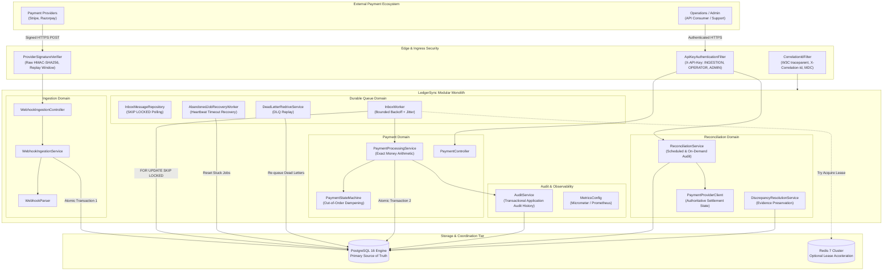
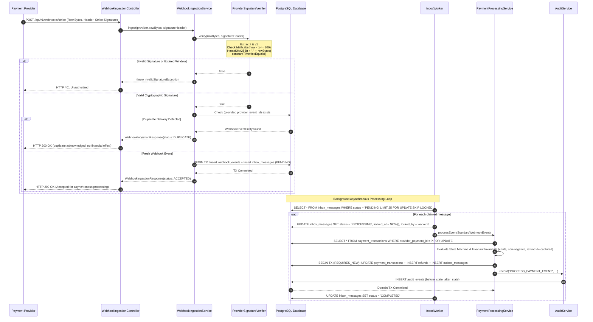
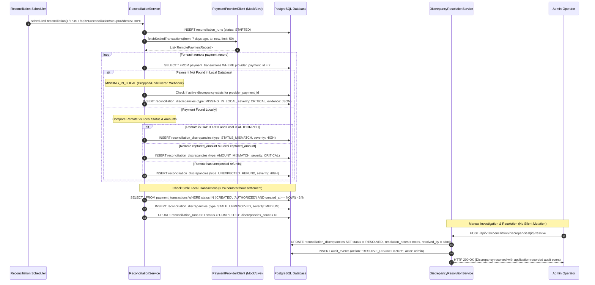
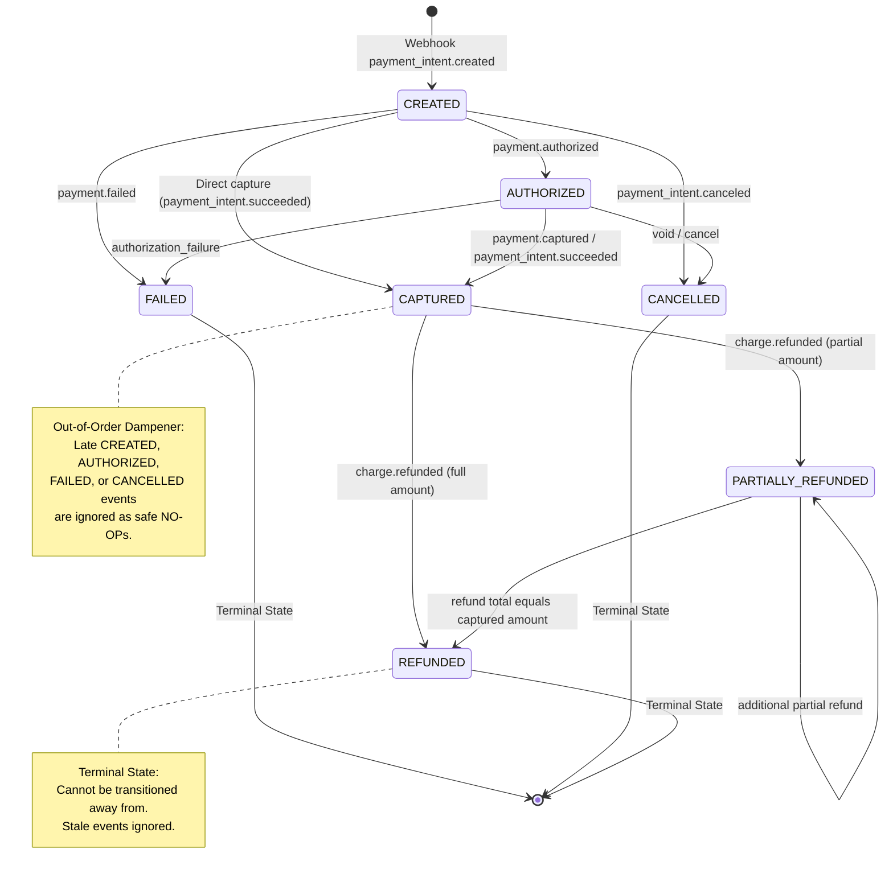

# LedgerSync — Technical Architecture & System Design

## 1. High-Level System Architecture

LedgerSync is a modular monolith in **Java 21** and **Spring Boot 3.3.x** with webhook/payment processing and CSV-based three-way finance reconciliation. Webhook delivery is treated as at-least-once: provider-scoped event identity, database transactions, and state checks reduce duplicate effects, but the system does not claim a global exactly-once guarantee.



---

## 2. Webhook Ingestion & Processing Sequence

The ingestion flow decouples incoming HTTP receipt from domain processing. Incoming payloads are verified using constant-time cryptographic comparisons against raw bytes, checked against timestamp replay windows, and persisted into both `webhook_events` and `inbox_messages` in a single ACID database transaction before an HTTP acknowledgment is sent.



---

## 3. Failure & Recovery Sequence

The asynchronous pipeline is resilient to transient failures, poison pills, worker node crashes, and network partitions.

```mermaid
sequenceDiagram
    autonumber
    participant W as InboxWorker
    participant R as AbandonedJobRecoveryWorker
    participant DB as PostgreSQL Database
    participant DLQ as DeadLetterRedriveService
    participant Admin as Operator / Admin

    Note over W,DB: Scenario A: Transient Failure & Exponential Backoff
    W->>DB: Claim pending message
    W->>W: processEvent() fails (e.g. database deadlock or transient lock timeout)
    W->>W: Calculate backoff: min(60s, 1000ms * 2^attempt) + jitter(100ms..500ms)
    alt attempt < maxAttempts (5)
        W->>DB: UPDATE inbox_messages SET status = 'PENDING', scheduled_at = NOW() + backoff, attempt_count = attempt + 1
        Note over W,DB: Job sleeps until scheduled_at without blocking worker thread
    else attempt >= maxAttempts
        W->>DB: UPDATE inbox_messages SET status = 'DEAD_LETTER', last_error = exceptionDetails
        Note over W,DB: Job quarantined in DLQ; alerts raised via Micrometer counter
    end

    Note over R,DB: Scenario B: Worker Node Hard Crash (SIGKILL / Out-Of-Memory)
    Note over W: Worker node terminates abruptly while job status = 'PROCESSING'
    R->>DB: SELECT * FROM inbox_messages WHERE status = 'PROCESSING' AND locked_at <= NOW() - 300s
    DB-->>R: Returns abandoned message
    R->>DB: UPDATE inbox_messages SET status = 'PENDING', locked_at = NULL, locked_by = NULL, attempt_count = attempt + 1

    Note over DLQ,Admin: Scenario C: Controlled Dead-Letter Redrive
    Admin->>DLQ: POST /api/v1/queue/redrive/{id} (X-API-Key: admin-secret-key)
    DLQ->>DB: SELECT * FROM inbox_messages WHERE id = ? AND status = 'DEAD_LETTER'
    DLQ->>DB: UPDATE inbox_messages SET status = 'PENDING', attempt_count = 0, scheduled_at = NOW()
    DLQ->>DB: INSERT audit_events (action: "REDRIVE_DEAD_LETTER", actor: admin)
    DLQ-->>Admin: HTTP 200 OK (Message re-queued without rewriting original history)
```

---

## 4. Independent Reconciliation Sequence

Reconciliation is an independent audit control loop that actively detects balance and status drift between local database records and authoritative provider settlement state.



---

## 5. Payment Lifecycle & State Transition Diagram

The state machine explicitly restricts transitions and handles delayed, duplicate, and out-of-order events. Out-of-order events arriving for already captured or refunded payments are safely dampened (treated as NO-OPs) without corrupting financial records.



---

## 6. Component Responsibilities & Data Ownership

| Component | Responsibility | Data Ownership |
| :--- | :--- | :--- |
| **`WebhookIngestionService`** | Verifies HMAC, parses JSON payload, checks provider-scoped uniqueness, and writes to durable inbox. | Writes to `webhook_events`, `inbox_messages`. |
| **`InboxWorker`** | Polls database using `FOR UPDATE SKIP LOCKED`, coordinates retries with jitter, and updates message states. | Updates `inbox_messages`. |
| **`AbandonedJobRecoveryWorker`** | Detects crashed worker locks (`locked_at <= NOW() - 300s`) and resets jobs to `PENDING`. | Updates `inbox_messages`. |
| **`PaymentProcessingService`** | Validates monetary invariants, applies state transitions, records refunds, and enqueues outbox events. | Writes to `payment_transactions`, `refunds`, `outbox_messages`. |
| **`AuditService`** | Records application audit events in the same transaction as domain updates. | Writes to `audit_events`; database administrators can still alter rows. |
| **`ReconciliationService`** | Queries authoritative provider clients, identifies missing webhooks or drift, and creates discrepancies. | Writes to `reconciliation_runs`, `reconciliation_discrepancies`. |
| **`DiscrepancyResolutionService`** | Enforces admin-only resolution of discrepancies and preserves investigation evidence. | Updates `reconciliation_discrepancies`, writes to `audit_events`. |

---

## 7. Key Engineering Decisions & Trade-Offs

1. **PostgreSQL SKIP LOCKED vs Kafka**:
   - *Decision*: Built with PostgreSQL `FOR UPDATE SKIP LOCKED` for the transactional inbox.
   - *Trade-off*: Keeps the transactional inbox in PostgreSQL and avoids a separate broker dual-write path. Throughput limits have not been benchmarked.
2. **Exact Minor Units (`long amountMinor`) vs Floating Point (`double`)**:
   - *Decision*: Persisted financial amounts use integer minor units and CSV amounts are converted with decimal arithmetic; the finance path avoids binary floating-point money calculations.
3. **Redis as Acceleration vs Source of Truth**:
   - *Decision*: Redis is used strictly for transient leader lease coordination via `OptionalRedisCoordinator`.
   - *Trade-off*: PostgreSQL is the durable queue/state source; tests cover fallback behavior, but production outage recovery and throughput have not been load-tested.
4. **No Silent Auto-Correction**:
   - *Decision*: When reconciliation discovers discrepancies (e.g. `STATUS_MISMATCH` or `AMOUNT_MISMATCH`), the engine refuses to silently overwrite local balances.
   - *Trade-off*: Preserves source records and records decisions for review. The application audit history is not a cryptographic or database-admin-proof immutable ledger.
